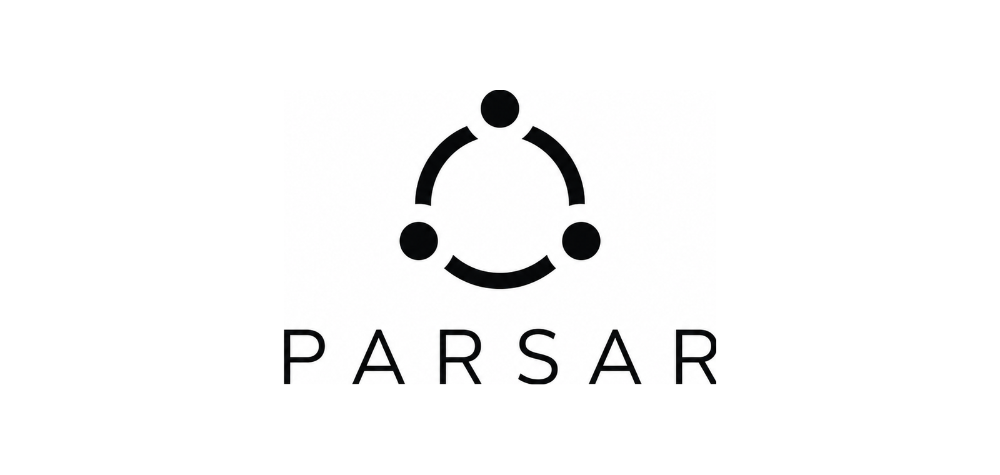

<p align="center">
  
</p>

<p align="center">
  <b>Your team's intent, parsed into action.</b>
  <br />
  The open-source agent collaboration control plane for engineering teams.
</p>

> [!WARNING]
> **Alpha — under active development, not production-ready.**
> APIs, schemas, and configs may change without notice between commits.

## What is Parsar

Parsar is a team-first platform for dispatching, managing, and auditing AI coding agents. Send tasks from the tools your team already uses — chat, web UI, API — and get results back where they started: a thread, a PR, a webhook.

Agent execution goes through the independently deployed Agents API Core, whose
qualified profiles include **Claude Code**, **Codex**, and **MiniMax Code**. Parsar
keeps its own database for members, business assets, permissions and collaboration.

### Why Parsar

- **Team-first.** Shared queues, run history, and permissions — not single-player agent loops.
- **Independent execution.** Core owns models, runtime environments and execution; Parsar uses its public Agents API.
- **Pluggable surfaces.** Feishu / Lark ships today; Slack, Discord, and webhooks on the roadmap.
- **Auditable.** Every run is persisted: prompt, diff, logs, exit code.
- **Self-hosted.** Your code, your secrets, your machine. No telemetry.

## Quick Start

Requires Bash, Docker running Linux containers, and Docker Compose v2.15 or newer
(on Linux, macOS, or WSL2). Start Docker before installing.

```bash
curl -fsSL https://raw.githubusercontent.com/MiniMax-AI-Dev/parsar/main/install.sh | bash
```

Open <http://127.0.0.1:18080> and create the first administrator account.
Configuration, secrets and data default to `~/.parsar/`. Back up this directory
before upgrading; keep `.env` with its matching database and encrypted data.

Rerun the installation command to upgrade. Existing settings are preserved;
explicit options or exported `PARSAR_*` installation settings override them.
For a custom directory or port, append options with `bash -s -- --home /absolute/path
--port 19090`. Use `--help` for all options and `--dry-run` to validate without
saving configuration or starting containers. Advanced settings belong in `.env`.
Use `--compose-file /absolute/path/docker-compose.yml` to retain a custom Compose
file; otherwise the installer uses the current checkout's file or downloads it.

The installer prints commands for status, logs and shutdown. Download, configuration
or image-pull failures leave existing files and services unchanged. Later failures
retain configuration and data so the same command can be retried after fixing the
reported error. It does not roll back database migrations or remove unrelated
containers, volumes or images. Normal exits and handled interruptions remove
temporary files and the installation lock; after a forced kill or power loss,
remove `<home>/.install.lock` and `<home>/.install.*` only after confirming no
installer is running. Never delete `.env` to resolve an installation error.

For a locally built server image, run `make docker-build`, then
`PARSAR_IMAGE_PULL_POLICY=never ./install.sh --image parsar:dev` from the checkout.

The default Compose stack starts PostgreSQL and the Parsar web control plane.
Deploy Core separately and configure a distinct Core project credential for each
workspace using the [product integration guide](docs/deploy/product-core.md).
Asset management works independently; Agent execution requires this connection.

## Contributing

Architecture, tech stack, development setup, and coding conventions are all in [CONTRIBUTING.md](CONTRIBUTING.md).

## Security

Found a vulnerability? Please file a private report via [GitHub Security Advisories](https://github.com/MiniMax-AI-Dev/parsar/security/advisories/new) — see [`SECURITY.md`](SECURITY.md) for the full policy.

## License

[MIT](LICENSE) — 100% open source, no "open core" split.
